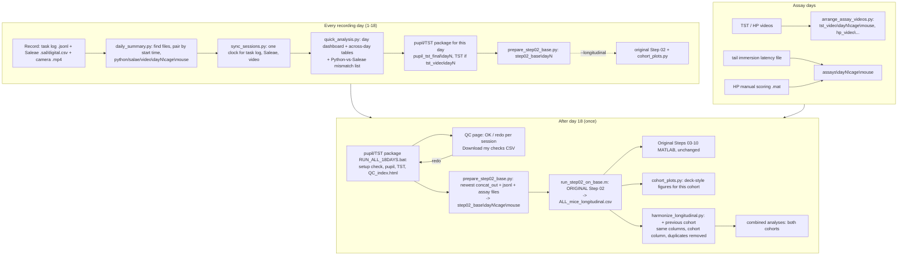

# Current-cohort workflow: logic and run order

This folder **adds** a workflow for a new cohort on the current rig. The previous MATLAB pipeline (`step01`–`step07` in this repository, plus `step08`–`step10` where present) is used **unchanged**:
- Step 02 is run through a wrapper that only sets `BASE`.
- Steps 03–10 read its `ALL_mice_longitudinal.csv` as before.

Everything new lives in `current_cohort_workflow/`.



## 1. Every day (5 minutes, `DAILY_summary.bat` in the cohort folder)

1. **Arrange.** `python/daily/daily_summary.py` finds the day's files wherever they were saved and pairs them by start time.
   - Pairing rules:
     - The Saleae capture starts 0–10 min before the task log.
     - The `digital.csv` reward pulses and camera TTLs must match the log.
     - The video file is created at the task start.
   - Destination: `python|salae|video\dayN\<cage>\<mouse>\`. Task logs are copied; Saleae and video files are moved.
   - Files still recording are not touched. Every move is logged in `_arrangement_log.csv`.
2. **Sync.** `sync_sessions.py` puts the task log, Saleae and video on one clock and writes `sync\`.
3. **Daily analysis.** `quick_analysis.py` writes `analysis\days\dayN\` (dashboard, rasters, cumulative licks, ILI, peri-reward licking, PR breakpoint on PR days) and the across-day tables (`analysis\master_day_level.csv`, ...).
   - Every Python-vs-Saleae mismatch is listed with its cause:
     - extra Arduino licks while the valve is open;
     - real licks inside the lockout;
     - timing-only differences.
4. **Pupil/TST (every day, default).** The pupil/TST package runs for that day only.
   - It writes a one-day config: `days=[N]`, ROI = previous day's ROI, `MATLAB -batch`.
   - The config copies the detector settings from `run_all_config.json`: `pupil_detector` `maxp` and the fine-tuned `pupil_model`. See `pupil_tst_patch/README.md` and `pupil_finetune/README.md`.
   - It takes about 10-20 min per session; use `--no-pupil` to skip it on a busy day.
   - The TST step runs automatically when `tst_video\dayN` has videos.
   - **Session grade.** `pupil_session_quality.py` grades every new session (`pupil_tst_final\pupil_session_quality.csv`): the manual grade in `pupil_tst_final\pupil_grades.csv`, else `ok` / `check` from two stability numbers. Sessions graded `guess` or `no_pupil` are left out of the daily pupil figures and tables; `pupil_guess_trace.py` gives them a labelled best-guess trace. A `check` session needs a look at its `qc_sheet.png` and a row in `pupil_grades.csv`.
   - **Alignment check and fix.** The same table has `align_check`. It compares the camera time of every video frame in the newest `concat_out_*` (the Step 02 input) with `sync_sessions.py`.
     - `MISMATCH` means the video has more or fewer frames than camera pulses. The package's `pupil_align_ttl` (the original Step 01a logic) then matches them at the end. On this rig the video starts with the first pulse, so licks and rewards end up shifted against the pupil.
     - Nothing changes until the user approves. For an approved session (a row in `pupil_tst_final\alignment_fixes.csv`), `fix_concat_alignment.py` runs `matlab/pupil_align_ttl_sync.m`. This is the original function with one change: the frame-to-pulse match is read from `<session>_frames.csv`.
     - MATLAB first writes a temporary folder that no tool reads. That folder is renamed `concat_out_<stamp>_syncaligned`, next to the package's folder, only after these checks pass:
       - every row's camera time matches `sync_sessions.py`;
       - the lick and valve states at every camera pulse match the Saleae intervals;
       - there is one reward onset per valve opening.
     - Every attempt is logged in `alignment_fixes_log.csv`.
     - Every day, `daily_summary.py` re-applies all approved fixes (for example after a redo of an earlier day). It only lists new mismatches.
     - If an approved session's newest table is the package's again, `prepare_step02_base.py` leaves that session as it is until the fix has been re-applied.
   - **Fully dilated pupils (an option for rare sessions).** When the whole eye is dark, the pupil is the whole dark area inside the lids. The package cannot measure this (see `pupil_finetune/README.md`).
     - Only sessions the user lists in `pupil_tst_final\fullpupil_sessions.csv` are measured this way (`fullpupil_sessions.py` -> `pupil_outputs_fullpupil\`). They get the grade `full_pupil` (used, marked), and Step 02 reads a `concat_out_<stamp>_fullpupil` copy.
     - **Mouse option (automatic).** For mice listed in `pupil_tst_final\fullpupil_mice.csv`, every session on every day is checked.
       - The full-pupil pass also measures, on every frame, the black region around the tracker's pupil.
       - With `switch = session` (default), a session gets the full-pupil measure only when its median black region is larger than 60 px, the largest pupil the package can report.
       - Minutes that disagree with the rest are reported.
       - `switch = minute` switches minute by minute. It is off by default: on days 1-2 it gave false minutes on normal days and missed a dilated minute with a half-closed eye.
       - The decisions are written to `fullpupil_check.csv` and `fullpupil_auto.csv`.
       - An explicit `no` row in `fullpupil_sessions.csv` wins over an automatic yes.
       - The check is used only for the listed mice, because some narrowed or inflamed eyes also pass 60 px.
     - Nothing changes for any other session. A screen that looks for such sessions exists, but it runs only when asked (`--screen-only`) and also flags some normal eyes.
     - The alignment fix above works the same way: an option for the sessions listed in `alignment_fixes.csv`.
   - **Eye-box check.** `pupil_roi_check.py` writes `analysis\days\dayN\figs\01_pupil_roi_check.png`: 3 frames per mouse with its ROI, the tracker's "no pupil" fraction and the session grade. Mice sit differently every day. If an eye is outside its box, set `redraw_roi` and run `RUN_ALL_18DAYS.bat` for that session.
   - Because every day is done the same evening, the day-18 `RUN_ALL_18DAYS.bat` only has to build the QC page and redo the sessions marked *redo*. Finished sessions are skipped.
5. **Step 02 base (every day, all days).** `prepare_step02_base.py` copies each session's newest `concat_out_*`, its task log and the assay files into `step02_base\dayN\...`.
   - Copies that are already there are left alone.
   - An older copy, replaced by a checked `_syncaligned` copy or by a redo, is moved to `step02_base\_superseded_<date>\`. That folder is outside the `dayN` folders, so Step 02 does not count it as a second session. Each move is also recorded in `step02_base_moves.csv`.
   - `daily_summary.py --longitudinal` also rebuilds `ALL_mice_longitudinal.csv` with the original Step 02 and makes the cohort figures, so the data are ready for post-hoc analysis at any time.

Session names (task-log `output=`) must be `<cage><mouse>_<task>day<N>`, e.g. `9670fgreen1_pr1day3`; a passive (replay) session on days 6–10 is `<cage><mouse>_passiveday<N>`. The name sets `dayN\<cage>\<mouse>`.

### Checks after each session and every evening (report only, added 2026-11-15)

Expected values per day are in `python/daily/protocol_expected.csv` (paradigm, requirement start and step, valve open time, lockout, session length, pump, Saleae glitch filters). An empty cell means no expectation: the value is reported, never flagged. Days 6–10 have two rows, active PR and passive replay (`LogReplayExperiment`, morphine through the valve as in the previous cohort); each session is checked against the row of its task-log paradigm.

- **`session_check.py` (`SESSION_CHECK.bat`), right after each session.** Read-only. It finds the newest session with the same pairing as `daily_summary.py` and prints PASS / CHECK with numbers for:
  - the file name: cage, mouse and day number, and the same mouse used twice on one date;
  - the protocol in the task log, including the measured lockout (`reward_cmd` to the next `trial_start`);
  - the valve open time and the reward count on the Saleae;
  - Python-only licks that the task counted;
  - camera frames vs pulses, and whether the video was stopped after the task ended;
  - the Saleae settings.

  On a passive (replay) log it also checks the log that was replayed (`replay_source`): found, another mouse, started on the same date and finished before the passive session, not a replay itself; the pair in `cohort_manifest.csv` when `group` / `pair_id` are filled; and the replayed rewards (same count, times within 0.5 s of the source's; 60 complete replays of the previous cohorts lagged 0.02–0.24 s).

  Run on a `test_...` log, it checks only the valve time and the Saleae settings, for the test before the first mouse. Outputs go to `analysis\session_checks\`. `daily_summary.py` also runs it with `--all` for the day.
- **`pr_daily_checks.py`, every evening after `quick_analysis.py`.** It writes one row per mouse to `analysis\days\dayN\pr_checks_dayN.txt/.csv` and `figs\12_pr_checks.png`:
  - valve open time vs the expected value and between mice;
  - measured vs logged lockout;
  - Python-only licks that counted toward a ratio;
  - session length, last reward and final gap;
  - PR for the whole session and in the first 910 s, next to the previous cohort's days 3–5 (reference only).

  The previous-cohort reference is cached in `analysis\reference\prev_cohort_pr_days3to5.csv`. A passive session has no PR columns; its reward count is compared with the replayed log's.
- The PR block for the task script (`TimedProgressiveRatioExperiment`, start 1 +1, lockout 0.2 s, valve only, 910-s auto-stop, `n_trials` 1000000) is pasted in by hand. `n_trials` 10000000000 makes the start-up hang: the task builds the whole requirement list before the first trial.
- Days 6–10: the same block with a replay switch. With a source log set, it runs `LogReplayExperiment` on the active partner's log of the same day: the valve opens at the partner's reward times, and the session lasts as long as the partner's. Before anything starts it stops if the source is missing, is itself a replay, has no `experiment_end`, or is from another date. A switch lets the last two through for a deliberate catch-up day. Quick analysis labels these sessions `PASSIVE` and gives them no PR or time-to-reward values. Step 02 marks them passive from the paradigm, as it did for `MicroLogReplayExperiment`.

## 2. Assay days (schedule: TI days 5–18, HP 5/10/13/16/18, TST 5/10/13/18)

- TST and HP videos: `python python/arrange_assay_videos.py --project <cohort> --day N --src <folder> --apply` copies them to `tst_video\dayN\<cage>\<mouse>\` and `hp_video\...`.
- Use the experiment day the assay belongs to; in the previous cohort the TST folder date was one day earlier than the Step 02 day.
- HP is scored by hand. Put `ManualScoringResults*hot*.mat` and the tail-immersion latency file in `assays\dayN\<cage>\<mouse>\`. `prepare_step02_base.py` copies them where Step 02 looks.

## 3. After day 18 (once, in this order)

1. **Pupil + TST.** Set `run_all_config.json` of the package (see `pupil_tst_patch/README.md`) and double-click `RUN_ALL_18DAYS.bat`.
   - In `QC_index.html`, mark each session OK or redo and press *Download my checks (CSV)*.
   - Redo sessions with `"redo"` / `"redraw_roi"` in the config, then rerun.
2. **Step 02 base.**
   ```bash
   python python/prepare_step02_base.py --pupil-out <pupil_tst_final> --python-root <python> --assays <assays> --base <step02_base> --apply
   ```
   - Only the newest `concat_out_*` per mouse-day is copied. Step 02 counts every `concat_out` folder as a session, which is how the previous cohort got duplicates.
   - It stops when a mouse-day has more than one task log.
   - For automatic TST results also run the package's `tst/tst_step02_copy.py --auto <TST_auto> --day-folder <step02_base>\dayN --apply`.
3. **Step 02 (original).** In MATLAB, from `current_cohort_workflow/matlab`:
   ```matlab
   run_step02_on_base('<step02_base>')
   ```
   This reads `step02_build_longitudinal/Longitudinal_final_....m`, replaces only its `BASE = '...'` line and runs it. It wrote outputs identical to the previous `run_009` for the previous cohort's day-1 sessions (14/14: frames, licks, rewards, Trial, RequirementLast, pupil).
4. **Downstream.**
   - The original Steps 03–10 run on the new `ALL_mice_longitudinal.csv` as before (MATLAB Statistics Toolbox needed).
   - `python/cohort_plots.py` makes the deck-style figures for the cohort (see `docs/ANALYSIS_METHODS.md`).
   - `python/plot_session_sync.py` makes the one-session pupil / lick / reward sync check.
5. **Combine with the previous cohort.**
   ```bash
   python python/harmonize_longitudinal.py --in dec2025=<run_009>\ALL_mice_longitudinal.csv --in <name>=<new run>\ALL_mice_longitudinal.csv --out <combined>\ALL_cohorts_longitudinal.csv
   ```
   - Columns are the union.
   - A `cohort` column is added.
   - Duplicate sessions are dropped and listed.
   - The script stops if a `mouse_key` exists in both cohorts.

## 4. Definitions (identical to the previous pipeline)

| Quantity | Definition | Source |
|---|---|---|
| Lick | 0→1 change of `Lick_TTL` between camera frames (Saleae lick line read at every camera pulse) | Step 01a / `pupil_align_ttl` |
| Reward | 0→1 change of `Injector_TTL` (Saleae reward/valve line read at every camera pulse) | same |
| Time | `CamTime_rel_s` (camera-pulse time from the first frame); rates use the camera time span | Step 02 |
| Trial | +1 at every reward onset; frames before the first reward are Trial 0 | Step 02 `assignTrialsSmart` |
| Trial requirement | `req` of that trial in the task log | Step 02 |
| PR breakpoint | `RequirementLast` = last `req` in the log = rewards + 1 (Step 03/06); Step 10 uses max Trial = rewards | Step 02 / Step 10 |
| Active / passive | task-log paradigm (`MicroLogReplay` = passive) | Step 02 |
| Python `valid` flag | not used by the previous pipeline | — |

- Frame-sampled lick counts are 0–11 % below the raw Saleae contacts, but proportional to them (r = 0.9995, previous cohort day 6 and day 13). The workflow also keeps raw Saleae and task-log counts for checks.
- Analysis rules (from the previous analysis, see the repository `CLAUDE.md`):
  - downstream statistics use `day_index >= 4`;
  - passive licks on days 6–10 (Period `During`) are masked;
  - rewards stay valid;
  - `PairID` pairs active and passive mice.

## 5. Protocol differences to record when combining cohorts

| | Previous cohort (Dec 2025) | Current cohort |
|---|---|---|
| Days 1–2 | MicroFR FR1 / FR3, pump 0.1 s, valve 100 ms (Saleae 99.7 ms), `post_reward_delay` 0.5 | FR3 / FR5, pump 0.5 s, `post_reward_delay` 0.5. Valve 200 ms in 5 day-1 sessions, then 500 ms after the 2026-11-12 15:32 firmware upload. Measured lockout 1.0 s (the log's meta says 0.7) |
| PR days | valve 180 ms (Saleae 179.8 ms; the saved firmware copies say 200), lockout 0.2 s, `post_reward_delay` 0, sessions stopped by hand at 13–17 min | valve 200 ms (user decision 2026-11-15; check the Saleae width), lockout 0.2 s, delay 0, auto-stop at 910 s (`TimedProgressiveRatioExperiment`) |
| Saleae | 10 MHz, 1.2 V, 1 µs glitch filter on Ch4/6/7 | 125 MHz; days 1–2 had a glitch filter on the camera channel only (1 µs on Ch4/6/7 expected from day 3) |
| Camera | DV .avi 720x540 | IC Capture .mp4 1920x1080, 30.26 Hz triggered on the falling edge (the mp4 header says 60 fps) |

Days 1–2 are training and are not analysed.
