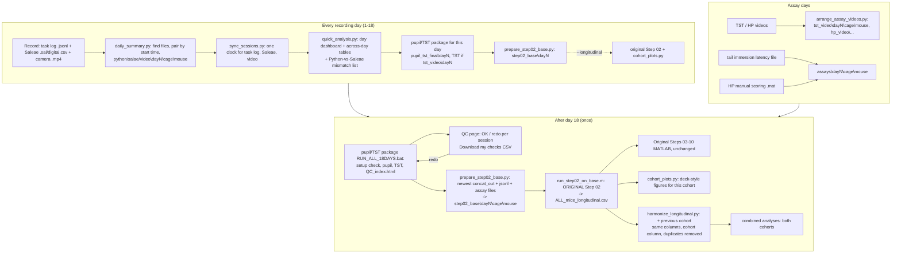

# Current-cohort workflow: logic and run order

This folder **adds** a workflow for a new cohort on the current rig. The previous MATLAB pipeline (`step01`–`step07` in this repository, plus `step08`–`step10` where present) is used **unchanged**:
- Step 02 is run through a wrapper that only sets `BASE`.
- Steps 03–10 read its `ALL_mice_longitudinal.csv` as before.

Everything new lives in `current_cohort_workflow/`.



## 1. Every day (5 minutes, `DAILY_summary.bat` in the cohort folder)

1. **Arrange.** `python/daily/daily_summary.py` finds the day's files wherever they were saved and pairs them by start time.
   - Pairing rules:
     - The Saleae capture starts 0–10 min before the task log.
     - The `digital.csv` reward pulses and camera TTLs must match the log.
     - The video file is created at the task start.
   - Destination: `python|salae|video\dayN\<cage>\<mouse>\`. Task logs are copied; Saleae and video files are moved.
   - Files still recording are not touched. Every move is logged in `_arrangement_log.csv`.
2. **Sync.** `sync_sessions.py` puts the task log, Saleae and video on one clock and writes `sync\`.
3. **Daily analysis.** `quick_analysis.py` writes `analysis\days\dayN\` (dashboard, rasters, cumulative licks, ILI, peri-reward licking, PR breakpoint on PR days) and the across-day tables (`analysis\master_day_level.csv`, ...).
   - Every Python-vs-Saleae mismatch is listed with its cause:
     - extra Arduino licks while the valve is open;
     - real licks inside the lockout;
     - timing-only differences.
4. **Pupil/TST (every day, default).** The pupil/TST package runs for that day only.
   - It writes a one-day config: `days=[N]`, ROI = previous day's ROI, `MATLAB -batch`.
   - It takes about 10 min per session; use `--no-pupil` to skip it on a busy day.
   - The TST step runs automatically when `tst_video\dayN` has videos.
   - Because every day is done the same evening, the day-18 `RUN_ALL_18DAYS.bat` only has to build the QC page and redo the sessions marked *redo*. Finished sessions are skipped.
5. **Step 02 base (every day).** `prepare_step02_base.py` copies the day's newest `concat_out_*`, its task log and the assay files into `step02_base\dayN\...`.
   - `daily_summary.py --longitudinal` also rebuilds `ALL_mice_longitudinal.csv` with the original Step 02 and makes the cohort figures, so the data are ready for post-hoc analysis at any time.

Session names (task-log `output=`) must be `<cage><mouse>_<task>day<N>`, e.g. `9670fgreen1_pr1day3`. The name sets `dayN\<cage>\<mouse>`.

## 2. Assay days (schedule: TI days 5–18, HP 5/10/13/16/18, TST 5/10/13/18)

- TST and HP videos: `python python/arrange_assay_videos.py --project <cohort> --day N --src <folder> --apply` copies them to `tst_video\dayN\<cage>\<mouse>\` and `hp_video\...`.
- Use the experiment day the assay belongs to; in the previous cohort the TST folder date was one day earlier than the Step 02 day.
- HP is scored by hand. Put `ManualScoringResults*hot*.mat` and the tail-immersion latency file in `assays\dayN\<cage>\<mouse>\`. `prepare_step02_base.py` copies them where Step 02 looks.

## 3. After day 18 (once, in this order)

1. **Pupil + TST.** Set `run_all_config.json` of the package (see `pupil_tst_patch/README.md`) and double-click `RUN_ALL_18DAYS.bat`.
   - In `QC_index.html`, mark each session OK or redo and press *Download my checks (CSV)*.
   - Redo sessions with `"redo"` / `"redraw_roi"` in the config, then rerun.
2. **Step 02 base.**
   ```bash
   python python/prepare_step02_base.py --pupil-out <pupil_tst_final> --python-root <python> --assays <assays> --base <step02_base> --apply
   ```
   - Only the newest `concat_out_*` per mouse-day is copied. Step 02 counts every `concat_out` folder as a session, which is how the previous cohort got duplicates.
   - It stops when a mouse-day has more than one task log.
   - For automatic TST results also run the package's `tst/tst_step02_copy.py --auto <TST_auto> --day-folder <step02_base>\dayN --apply`.
3. **Step 02 (original).** In MATLAB, from `current_cohort_workflow/matlab`:
   ```matlab
   run_step02_on_base('<step02_base>')
   ```
   This reads `step02_build_longitudinal/Longitudinal_final_....m`, replaces only its `BASE = '...'` line and runs it. It wrote outputs identical to the previous `run_009` for the previous cohort's day-1 sessions (14/14: frames, licks, rewards, Trial, RequirementLast, pupil).
4. **Downstream.**
   - The original Steps 03–10 run on the new `ALL_mice_longitudinal.csv` as before (MATLAB Statistics Toolbox needed).
   - `python/cohort_plots.py` makes the deck-style figures for the cohort (see `docs/ANALYSIS_METHODS.md`).
   - `python/plot_session_sync.py` makes the one-session pupil / lick / reward sync check.
5. **Combine with the previous cohort.**
   ```bash
   python python/harmonize_longitudinal.py --in dec2025=<run_009>\ALL_mice_longitudinal.csv --in <name>=<new run>\ALL_mice_longitudinal.csv --out <combined>\ALL_cohorts_longitudinal.csv
   ```
   - Columns are the union.
   - A `cohort` column is added.
   - Duplicate sessions are dropped and listed.
   - The script stops if a `mouse_key` exists in both cohorts.

## 4. Definitions (identical to the previous pipeline)

| Quantity | Definition | Source |
|---|---|---|
| Lick | 0→1 change of `Lick_TTL` between camera frames (Saleae lick line read at every camera pulse) | Step 01a / `pupil_align_ttl` |
| Reward | 0→1 change of `Injector_TTL` (Saleae reward/valve line read at every camera pulse) | same |
| Time | `CamTime_rel_s` (camera-pulse time from the first frame); rates use the camera time span | Step 02 |
| Trial | +1 at every reward onset; frames before the first reward are Trial 0 | Step 02 `assignTrialsSmart` |
| Trial requirement | `req` of that trial in the task log | Step 02 |
| PR breakpoint | `RequirementLast` = last `req` in the log = rewards + 1 (Step 03/06); Step 10 uses max Trial = rewards | Step 02 / Step 10 |
| Active / passive | task-log paradigm (`MicroLogReplay` = passive) | Step 02 |
| Python `valid` flag | not used by the previous pipeline | — |

- Frame-sampled lick counts are 0–11 % below the raw Saleae contacts, but proportional to them (r = 0.9995, previous cohort day 6 and day 13). The workflow also keeps raw Saleae and task-log counts for checks.
- Analysis rules (from the previous analysis, see the repository `CLAUDE.md`):
  - downstream statistics use `day_index >= 4`;
  - passive licks on days 6–10 (Period `During`) are masked;
  - rewards stay valid;
  - `PairID` pairs active and passive mice.

## 5. Protocol differences to record when combining cohorts

| | Previous cohort (Dec 2025) | Current cohort |
|---|---|---|
| Days 1–2 | MicroFR FR1 / FR3, pump 0.1 s, valve 100 ms, lockout 0.7 s | FR3 / FR5, pump 0.5 s, valve 200→500 ms, lockout 0.7 s |
| PR days | valve 180 ms, lockout 0.2 s, `post_reward_delay` 0 | valve 200 ms (from day 3), lockout 0.2 s, delay 0 |
| Saleae | 10 MHz, 1.2 V, 1 µs glitch filter on Ch4/6/7 | 125 MHz, glitch filter on the camera channel only |
| Camera | DV .avi 720x540 | IC Capture .mp4 1920x1080, ~30.5 Hz triggered |

Days 1–2 are training and are not analysed.
